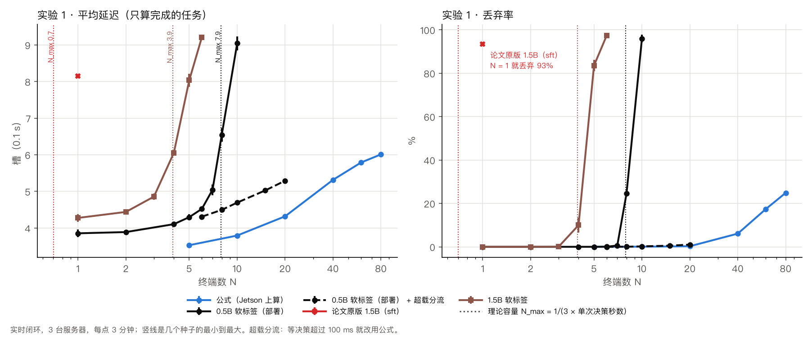
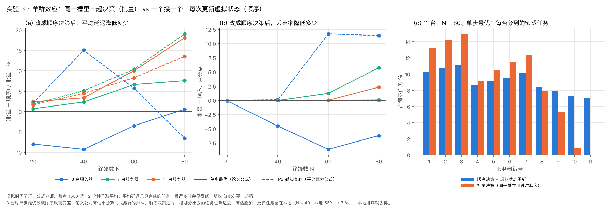
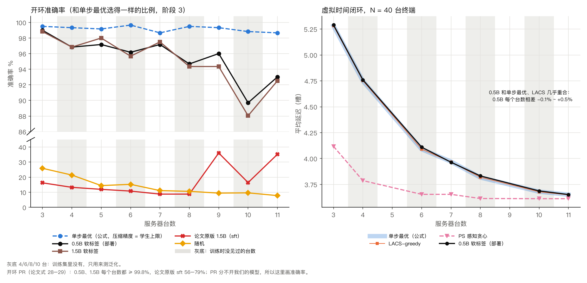
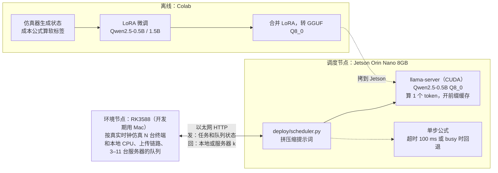

# comllm-edge-scheduler

**English summary.** This repository deploys an LLM-based task-offloading scheduler for mobile edge computing on an NVIDIA Jetson Orin Nano 8GB, building on the open-source paper COMLLM (Yang, Cheng and Zhang, [arXiv:2604.07148](https://arxiv.org/abs/2604.07148)). Qwen2.5-0.5B/1.5B are LoRA-fine-tuned on soft labels from the paper's one-step cost model and served by llama.cpp (CUDA) with a compact prompt, a one-token answer and prefix caching. An environment node simulates terminals and edge servers in real time and asks the Jetson for every decision over Ethernet, so decision latency counts toward task delay. Measured on the board, a decision takes 55.0 ms p50 / 72.0 ms p99, against 945.2 ms p50 for the paper-format 1.5B model on the same board. One scheduler node stays stable up to 7 terminals (theory 7.9), and up to at least 20 with overload shedding. In simulation, sequential decisions with virtual state updates cut mean delay by 18.1% against batch herding (11 servers, 80 terminals), and the 0.5B model stays within −0.1% to +0.5% of the one-step optimum across seven server counts from 3 to 11, including four never seen in training. We also train a second 0.5B whose teacher is a processor-sharing-aware version of the paper's delay formula; in a 3-server closed loop it cuts mean delay by a further 9.9–19.6% (simulation, one seed; the simulator itself uses processor sharing, which favours this teacher). We also reproduce a 7B model with the paper's recipe (GRPO from the authors' SFT-7B). It reaches PR 98.85–99.26% on the authors' cleaned test set, where only 2.45% of states favour local execution, but 71.55–75.32% on our two broader test sets (46–48% local-optimal), because after training it never chooses local execution; our paper-teacher students score 99.88–99.99% on all three. Running the same closed-loop points with the unquantized PyTorch students on Colab gives nearly the same mean delay and drop rate as the Q8_0 students on the Jetson in 17 of 18 model–load settings; the exception is a hard-label 1.5B student that, at the highest load, sometimes stops using one server on both platforms. All nine small models also have full 5,663-state Jetson Q8_0 open-loop predictions and 500-request latency coverage; deployment results are reported separately below. This is an independent project based on the paper, not an official COMLLM release. The documentation below is in Chinese.

基于开源论文 COMLLM（arXiv:2604.07148）的任务卸载调度器端侧部署。Jetson Orin Nano 8GB 做调度节点（llama.cpp/CUDA）；环境节点按真实时钟仿真终端和边缘服务器，经以太网向 Jetson 要每一个决策，决策的耗时算进任务延迟。环境节点最终用 RK3588，开发期用 Mac 代替。

> 状态（2026-11-13）：九个小模型在 Colab/PyTorch 和 Jetson/Q8_0 上的全量开环已齐，六学生两平台核心闭环各 36/36，Jetson 九模型 500 请求延迟基准已覆盖（部分复用）。7B 开环结果与复现边界见对应章节，7B 闭环进度另行验收。RK3588 两板复测仍按原计划安排；当前实时数字均使用 Mac 作为环境节点。

## 这个项目做了两件事

1. **在论文的评价体系里，把更小的模型和 7B 放在一起比。** 开环、用论文的单步最优打分（准确率、PR，式 28–29），比我们的 0.5B/1.5B、原作者的 1.5B 和 COMLLM-7B。论文报的 COMLLM-7B 是 96.86%，权重拿不到，所以按论文方法从原作者的 SFT-7B 复现一个（复现的不一定等于原版）。三套测试集的本地最优占比从 2.45% 到 47.97% 不等，所以分开报，并单独报本地召回（见"和 7B 比"）。部署的 0.5B 在 Jetson 上一次决策 55 ms。
2. **在论文自己的假设下，换一个更贴合这个假设的老师。** 论文假设服务器平分算力（式 4），调度和打分用的时延近似在高负载时偏悲观。按式 4 推出 PS 感知公式当第二个老师，同样训练 0.5B/1.5B 学生；闭环里先比两个老师，再比各自的学生。

两部分的学生学的都是公式，不是 7B 模型的输出。开环和闭环在 Colab（PyTorch 原精度）和 Jetson（GGUF Q8_0）上分别跑，两边的差别就是部署带来的变化；7B 只在 Colab 上跑。

## 结果一览

全部实测；标"仿真"的是在仿真器里跑出来的。每个数字来自哪个运行目录，见 [figures/numbers.md](figures/numbers.md)。

| 问题 | 结果 | 条件 | 图 |
|---|---|---|---|
| 一次决策要多久 | 部署配置 p50 55.0 ms、p99 72.0 ms；同一块板上论文原版 1.5B（论文格式）p50 945.2 ms | Jetson 端到端，环境节点计时，500 次，3/7/11 台服务器轮流。部署配置 = 0.5B Q8_0 + 压缩提示词 + 1 个 token + 前缀缓存 | 图 2 |
| 同样大小（1.5B）能快多少 | 压缩提示词 + 前缀缓存 p50 118.0 ms，论文格式 945.2 ms；平均提示词 278 token 对 1358 token | 同上 | 图 2 |
| 一个调度节点撑得住多少终端 | 0.5B 最多 7 台（理论 7.9）；加超载分流后测到的 20 台也稳，丢弃 1.0%；论文原版 1.5B 1 台就丢 93.4% | 实时闭环，3 台服务器，每点 3 分钟、2 个种子 | 图 1 |
| 批量决策的羊群效应 | 改成顺序决策 + 虚拟状态更新：平均延迟 5.11 → 4.19 槽（−18.1%），丢弃 2.4% → 0.1%。3 台服务器时反而变差（+9.3%），原因见下面"局限" | 仿真，11 台服务器、80 台终端，单步最优公式 | 图 3 |
| 没见过的服务器台数 | 0.5B 闭环平均延迟和单步最优差 −0.1% ~ +0.5%；开环准确率 96.5%（见过的台数）、94.4%（没见过的台数） | 闭环：仿真，N = 40，3/4/6/7/8/10/11 台；开环：3010 条和 2408 条 | 图 4 |
| PS 公式和论文公式在闭环里比 | 公式对公式：PS 公式平均延迟平均低 9.27%（−22.73% ~ +3.79%）。照它们训练的两个 0.5B：PS 那个低 13.4% / 19.6% / 9.9%，丢弃 0.1% / 5.9% / 17.3% → 0.0% / 0.0% / 0.9% | 仿真，虚拟时间闭环，顺序决策。公式：3/7/11 台 × N = 20–80，3 个种子；0.5B：3 台、N = 20/40/60，1 个种子。仿真器按论文式 4 的平分算力排队，结论只适用于这种服务器 | 图 6、图 7 |
| 和原作者的 1.5B 比 | 准确率（见过的台数 / 没见过的台数 / 原作者干净测试集）：我们的 0.5B 96.5% / 94.4% / 95.9%，原作者 sft 1.5B 21.7% / 12.3% / 13.5% | 3010 / 2408 / 245 条，贪心解码；准确率 = 和单步最优选得一样的比例。复现的 7B 见"和 7B 比" | 图 6 |








另外三张图：[图 5 开环 vs 闭环](figures/fig5_open_vs_closed.png)、[图 6 消融](figures/fig6_ablation.png)、[图 7 LACS 在闭环里的效果](figures/fig7_lacs.png)。

## 两个老师：开环和闭环要分开看

论文的开环指标（AL、PR，式 26–29）在一组互相独立的状态上，用论文的时延公式给每个决策打分，参照答案是这个公式下的单步最优。所以开环比的其实是模型有多像这个公式。部署的 0.5B 在见过的台数、没见过的台数和原作者干净测试集上 PR 分别是 99.98%、99.95%、99.94%，已经接近上限。论文的 LACS 在 λ = 0.3 下几乎不改变决策：闭环里 99.7% 的决策和单步最优一样，平均延迟只差 +0.04%（仿真）。

所以开环只用这一把尺子：我们的模型和论文原版模型都按单步最优打分。

闭环里每个决策都会改变后面任务看到的队列，延迟和丢弃率由仿真器里真实发生的排队决定，比的是对眼前和后面积压的处理。我们发现论文的时延近似在平分算力（PS）服务器上、高负载时偏悲观：已有的积压被算了两遍，上传期间服务器已经处理掉的积压也没扣掉。按论文自己的 PS 服务器模型（式 4）推出 PS 感知公式，用它当第二个老师，同样训练一个 0.5B。闭环里比的就是这两个公式，以及照它们训练的两个 0.5B（虚拟时间，顺序决策）：

| | 论文公式当老师（部署） | PS 感知公式当老师 |
|---|---|---|
| 公式对公式，3/7/11 台 × N = 20–80（12 个点，3 个种子） | 基准 | 平均延迟平均低 9.27%，范围 −22.73% ~ +3.79% |
| 公式本身，3 台、N = 40 | 5.28 槽，丢弃 6.0% | 4.12 槽，丢弃 0.0% |
| 0.5B 学生，3 台、N = 40 | 5.29 槽，丢弃 5.9% | 4.25 槽，丢弃 0.0% |
| 学生比自己的老师，3 台、N = 20/40/60 | −0.1% ~ +0.2% | −1.6% ~ +3.2% |
| 开环：论文的 PR（见过的台数 / 没见过的台数 / 原作者干净测试集） | 99.98% / 99.95% / 99.94% | 65.7% / 66.6% / 74.1% |
| 台数泛化（闭环，3–11 台） | 和单步最优差 −0.1% ~ +0.5% | 0.5B 和 PS 老师差 −1.1% ~ +4.0%（N = 40，7 档台数，种子 0） |
| Jetson：单次决策 / 实时稳定边界 | 55.0 ms / 7 台终端 | 51.55 ms（延迟基准）/ 实时稳定边界未测 |

PS 公式在轻负载时和论文公式差不多（N = 20 时 7 台慢 0.07%、11 台慢 3.79%），负载越高越占优（7 台、N = 80 时快 22.73%）。PS 学生在开环 PR 上只有 65.7%–74.1%，因为开环的尺子就是论文公式；它好不好要看闭环。

比法对两个公式是一样的：同一个仿真器、同一串任务、同样的种子，两个公式看到的信息也一样。仿真器的服务器按论文式 4 自己写的平分算力排队，PS 感知公式正是从这个假设推出来的，所以这是在论文自己的假设下比，PS 公式更贴合这个假设。结论只适用于平分算力的服务器；先来先服务的服务器上谁更好要另外测，这个对照还没做。

## 和 7B 比：三套测试集分开看

开环有三套测试集，"本地最优"（留在终端本地算最快）的占比差得很远：

| | 见过的台数（3/5/7/9/11） | 没见过的台数（4/6/8/10） | 原作者干净测试集 |
|---|---|---|---|
| 条数 | 3010 | 2408 | 245 |
| 本地最优占比 | 47.97% | 45.93% | 2.45%（6 条） |
| 从不选本地时准确率最多能到 | 52.03% | 54.07% | 97.55% |

原作者干净测试集是原作者的测试文件（306 条）去掉和原作者训练数据重合的 61 条后剩下的。去掉的 61 条里 41 条本地最优，所以剩下的几乎不考本地，只看这一套看不出模型会不会选本地。下面两张表都来自 [evidence/G6/open_loop.md](evidence/G6/open_loop.md)，那里还有 PS 老师的学生、公式基线，以及按服务器台数和终端数 N 的分解。

准确率 / PR（%）：

| 模型 | 见过的台数 | 没见过的台数 | 原作者干净测试集 |
|---|---|---|---|
| 我们的 0.5B 软标签（部署） | 96.5 / 99.98 | 94.4 / 99.95 | 95.9 / 99.94 |
| 我们的 1.5B 软标签 | 96.2 / 99.98 | 93.7 / 99.94 | 98.0 / 99.98 |
| 我们的 1.5B 硬标签 | 96.0 / 99.88 | 95.2 / 99.93 | 99.2 / 99.99 |
| 复现的 7B，λ = 0.3（论文 LACS） | 34.4 / 71.55 | 33.8 / 72.77 | 87.8 / 98.85 |
| 复现的 7B，λ = 0 | 34.8 / 72.53 | 34.6 / 75.32 | 88.6 / 99.26 |
| 原作者 SFT-7B（复现的起点） | 39.8 / 76.50 | 39.5 / 75.92 | 20.4 / 65.07 |
| 原作者 1.5B sft | 21.7 / 65.20 | 12.3 / 64.50 | 13.5 / 70.44 |
| 原作者 1.5B GRPO | 14.8 / 64.37 | 10.4 / 64.28 | 13.9 / 74.19 |
| 原作者 1.5B score-GRPO | 17.8 / 64.82 | 10.6 / 64.38 | 13.5 / 72.53 |

本地召回 · 本地精确：召回 = 本地最优的状态里选了本地的比例，精确 = 选了本地的状态里本地确实最优的比例。前两套是 %，原作者干净测试集只有 6 条本地最优，写条数：

| 模型 | 见过的台数 | 没见过的台数 | 原作者干净测试集 |
|---|---|---|---|
| 我们的 0.5B 软标签（部署） | 99.6 · 98.4 | 99.5 · 97.2 | 6/6 · 6/6 |
| 我们的 1.5B 软标签 | 99.5 · 98.4 | 99.1 · 97.4 | 6/6 · 6/6 |
| 我们的 1.5B 硬标签 | 99.1 · 97.2 | 99.3 · 97.3 | 5/6 · 5/5 |
| 复现的 7B，λ = 0.3（论文 LACS） | 0 · 没选过本地 | 0 · 没选过本地 | 0/6 · 没选过本地 |
| 复现的 7B，λ = 0 | 0 · 没选过本地 | 0 · 没选过本地 | 0/6 · 没选过本地 |
| 原作者 SFT-7B（复现的起点） | 67.5 · 49.9 | 74.4 · 46.4 | 6/6 · 6/166 |
| 原作者 1.5B sft | 28.5 · 40.0 | 6.6 · 32.7 | 0/6 · 0/38 |
| 原作者 1.5B GRPO | 11.0 · 39.5 | 0.4 · 30.8 | 0/6 · 0/5 |
| 原作者 1.5B score-GRPO | 18.8 · 41.9 | 1.8 · 27.0 | 0/6 · 0/14 |

**复现的 7B 在原作者干净测试集上接近上限，换到另外两套就掉下来。** 做法：从原作者的 SFT-7B 出发，按论文方法做 GRPO，λ = 0.3 和 λ = 0 各训一个（Colab，830 条训练题，208 次更新，结果在 `runs/20261108T103821Z_s7_colab_7b`）。原作者干净测试集上 PR 98.85% / 99.26%，另外两套只有 71.55%–75.32%。主要原因是训练后完全不选本地：5663 条测试状态里一次都没选，而另外两套近一半状态本地最优。PR 掉得最多的正是本地最优多的地方。以 λ = 0.3、见过的台数为例：N = 5 时 PR 93.7%，N = 80 时 59.3%，这两档的本地最优占比是 21.6% 和 72.8%；3 台服务器时 59.0%，11 台时 87.0%。最优是某台服务器的状态上，它选对 62%–67%，也低于我们的三个学生（89%–94%）。

**本地动作是在 GRPO 前几步丢掉的。** 起点 SFT-7B 会选本地，但不看状态：在原作者干净测试集上选了 166 次本地，而本地最优只有 6 条。GRPO 用的 830 条训练题只有 49 条（5.9%）本地最优，网络排队全是 0，本地排队最多 3 槽，9 台和 11 台服务器的题里一条本地最优都没有；两套测试集都有本地最优，网络排队不为 0 的分别有 1008 条和 867 条。逐步审计了 λ = 0 那次训练：前 7 步采到 41 个本地回答，其中 35 个答在本该卸载的题上，29 个被罚；答对的 6 个只有 2 个被奖励。第 8 步到第 208 步的 3208 个回答里一个本地都没有。每题只采 4 个回答，约九成的题 4 个回答奖励几乎一样（标准差 < 1e-6），没有信号再把本地拉回来。在同一起点的单种子对照（`runs/20261108_s7_collapse_pair_v5`）里，第 6 次更新后，本地最优探针题上"本地执行"首 token 的平均概率从 SFT 的 75.43% 降到 11.34%，第 7 次后降到 5.75%；16 道探针题里有 7 道的这个 token 已被 top_p = 0.95 截掉。只把 top_p 改成 1，贪心解码仍然不选本地。每批换成一半本地最优的题，本地保住了，但 8 道该卸载的题也全选了本地。

排除过的原因：答案解析（两种解析口径结果一样）、奖励计算（59041 个动作的成本逐项对照，差 0）、λ（λ = 0 也一样）。修正 LoRA dropout 和重复惩罚两处训练与打分不一致后，按 λ = 0 重训一次，准确率是 31.96% / 31.98% / 85.71%，比修正前略低，本地仍是 0（`runs/20261108_s7_fixed_nolacs`）。

**怎么解读。** 这是"论文方法 + 原作者数据"的复现结果，不等于原版 COMLLM-7B，论文报的 96.86% 也不和这里的数字放在一起比。它说明只用原作者干净测试集评，会把"不会选本地"这个缺陷盖住。我们的学生在三套上都接近公式上限，但这不等于"小模型达到或超过 7B"。两边的训练数据、训练方法、提示词格式和模型大小都不一样，不是只差模型大小的对照。另外，前两套测试集出自我们自己的仿真器，学生就是在这个仿真器的状态分布上训练的，这对学生有利：和测试集完全相同的输入是 0 条，但对仿真器的适配没有排除。"同样的训练数据下，7B 和小模型谁强"这个问题没有回答，要回答得用更宽的数据重做 7B 的 SFT 和 GRPO。

## 部署前后的闭环：Colab 和 Jetson

六个学生在两边跑同一组虚拟时间闭环点：3 台服务器，N = 20/40/60，种子 0 和 1，每点 1000 槽，只统计第 200 槽以后到达的任务。仿真器、任务流和打分是同一份代码，两边每个点的任务数和决策数完全一样。Colab 上作答的是合并了 LoRA 的 bf16 PyTorch 模型（A100），Jetson 上是 GGUF Q8_0（llama.cpp）。两边都没有出现作答非法、回退单步公式的情况。Colab 的结果在 `runs/20261112T064150Z_s6_colab_loop`，Jetson 的在 `runs/20261107T071637Z_s5_virtual_e4a+e4b+e5`、`runs/20261108T044444Z_s5_virtual_e4ps_a` 和 `runs/20261108T094747Z_s5_virtual_e4ps_b`。

平均延迟（槽）· 丢弃率（%），每格是 Colab / Jetson，两个种子的平均：

| 模型 | N = 20 | N = 40 | N = 60 |
|---|---|---|---|
| 论文公式 0.5B 软标签（部署） | 4.23 / 4.23 · 0.2 / 0.1 | 5.28 / 5.27 · 6.3 / 6.3 | 5.69 / 5.68 · 16.7 / 16.4 |
| 论文公式 1.5B 软标签 | 4.24 / 4.24 · 0.2 / 0.2 | 5.27 / 5.26 · 6.4 / 6.3 | 5.68 / 5.68 · 16.6 / 16.5 |
| 论文公式 1.5B 硬标签 | 4.25 / 4.24 · 0.2 / 0.1 | 5.27 / 5.28 · 6.4 / 6.4 | 5.69 / 5.70 · 16.9 / 16.9 |
| PS 公式 0.5B 软标签 | 3.66 / 3.66 · 0.0 / 0.0 | 4.22 / 4.24 · 0.0 / 0.0 | 5.13 / 5.10 · 1.7 / 0.8 |
| PS 公式 1.5B 软标签 | 3.65 / 3.65 · 0.0 / 0.0 | 4.10 / 4.11 · 0.0 / 0.0 | 5.11 / 5.10 · 0.4 / 0.4 |
| PS 公式 1.5B 硬标签 | 3.70 / 3.70 · 0.0 / 0.0 | 4.22 / 4.23 · 0.0 / 0.0 | 4.75 / 4.86 · 27.3 / 15.2 |
| 论文公式本身 | 4.23 · 0.2 | 5.27 · 6.1 | 5.67 · 16.4 |
| PS 公式本身 | 3.66 · 0.0 | 4.10 · 0.0 | 5.18 · 0.6 |

最后两行是公式本身（种子 0、1），不经过模型，两边一样。

**18 组里 17 组两边几乎一样。** 平均延迟最多差 0.04 槽，丢弃率最多差 0.8 个百分点（PS 公式 0.5B，N = 60），和单步公式的一致率最多差 0.4 个百分点。这说明闭环的汇总指标接近，不说明两边每个决策都一样：PS 公式 1.5B 软标签做过 200 条单步核对，Q8_0 和合并后的 PyTorch 只有 148 条答案相同（`runs/20261108T094747Z_s5_virtual_e4ps_b` 里的 preflight_gate_stop.json）。

**例外是 PS 公式 1.5B 硬标签在 N = 60。** Colab 的两个种子在计分期间都没往服务器 3 派过任务，只分给服务器 1 和 2（约 2:1），丢弃 28.0% 和 26.5%。Jetson 的种子 0 也是这样（丢弃 28.5%），种子 1 三台都用（丢弃 2.0%）。两边平均 27.3% 对 15.2% 的差别，来自 Jetson 的种子 1 没落进这种状态。这个故障也出现在未量化的 Colab 模型上；现有结果还不能分离量化、推理实现和闭环状态分化各自的影响。同一点上 PS 公式本身丢弃 0.6%。为什么会停用服务器 3 还没查，两个种子也不够判断它多常发生。它的平均延迟看着最低（4.75 / 4.86 槽），是因为被丢的任务不计入延迟。

Colab 上同一个模型的 6 个点拼成一批作答，A100 上平均每次决策 8.3–9.9 ms，6 个模型一共约 70 分钟。这是批量摊下来的时间，不能和 Jetson 上的单次决策时间比。

## 部署后的开环：九个模型的固定测试集

九个小模型各在 Jetson 上重新回答 3010 条 Seen、2408 条 Unseen 和 245 条原作者干净测试状态，共 50,967 条预测。每个 `(split, idx)` 恰好一条，非 LLM 答案共 0 条；调度服务返回的超时、解析失败等非 LLM 回答以 −1 计入非法率，不把公式回退答案当成模型答案。
本轮开环与延迟测试给每次请求 10 秒作答；实时调度服务的默认 100 毫秒是另一项设置。模型为 Q8_0，llama.cpp 固定 5aeac37a3，上下文 4096，串行单请求；开环均开启前缀缓存，compact 取一个 token，paper 最多生成 20 个 token。

score-GRPO 中途遇到一次 HTTP 等待超时，板端已完成该次推理而客户端未收到回复。已有 4472 条原样保留，只续跑缺失的 1191 条；该次未落盘的尝试不计入表中，测试设置与服务均未改变。中断日志和已存前缀的校验值一并保留。

上面的开环表复用 Colab/PyTorch 预测；这里是板端结果。下面每格为准确率 / PR（%），最后一列是和既有 PyTorch 预测逐条相同的比例，包含全部状态，不剔除成本打平的状态。PS 学生也按论文成本评分，它们的训练目标不同。

| 模型 | Seen（3010） | Unseen（2408） | 原作者干净测试集（245） | 两平台逐条一致率：Seen / Unseen / 原作者（%） |
|---|---|---|---|---|
| 论文老师 0.5B 软标签 | 97.11 / 99.98 | 95.64 / 99.96 | 97.55 / 99.96 | 97.28 / 97.13 / 97.55 |
| 论文老师 1.5B 软标签 | 96.51 / 99.98 | 94.14 / 99.94 | 97.55 / 99.97 | 97.14 / 97.38 / 98.78 |
| 论文老师 1.5B 硬标签 | 95.85 / 99.88 | 95.22 / 99.93 | 99.18 / 99.99 | 99.57 / 99.63 / 100.00 |
| PS 老师 0.5B 软标签 | 18.17 / 65.82 | 18.77 / 66.93 | 13.47 / 74.40 | 73.82 / 69.77 / 72.24 |
| PS 老师 1.5B 软标签 | 18.70 / 65.90 | 18.56 / 66.46 | 14.69 / 75.07 | 72.33 / 76.95 / 66.53 |
| PS 老师 1.5B 硬标签 | 18.50 / 65.89 | 18.56 / 67.24 | 15.10 / 75.48 | 99.97 / 99.17 / 100.00 |
| 原作者 1.5B SFT | 23.12 / 65.43 | 16.32 / 65.10 | 11.84 / 66.15 | 94.42 / 86.13 / 82.86 |
| 原作者 1.5B GRPO | 11.06 / 64.05 | 10.17 / 64.23 | 13.88 / 74.58 | 87.14 / 90.74 / 97.96 |
| 原作者 1.5B score-GRPO | 15.08 / 64.61 | 11.25 / 64.36 | 13.06 / 73.28 | 86.31 / 88.87 / 93.06 |

PS 软标签两学生的逐条一致率为 66.53%–76.95%，论文 PR 相差最多 0.74 个百分点。PS 硬标签 1.5B 的静态一致率为 99.17%–100.00%，仍存在上一节 N = 60 的闭环不稳定现象。汇总分数和逐状态答案提供不同信息；这些结果不建立 PyTorch 等价性，差异也不能全部归因于 Q8。进一步等价性归因调查继续暂缓。

完整的本地召回、本地精确、按台数和 N 分解、预测来源及 SHA 见 [板端开环报告](evidence/G6/jetson_open/comparison.md)、[逐条一致率](evidence/G6/jetson_open/prediction_agreement.md) 和 [完整打分表](evidence/G6/jetson_open/open_loop.md)。

**单次决策延迟基准。** 每组 500 次计入、10 次热身，3/7/11 台服务器轮流。学生用 compact / cache on，原作者模型用 paper / cache off。两个已有学生基准复用；新增缺失六组，并额外重测 SFT，使原作者三模型使用同一版明确固定的贪心参数（历史 SFT 基准早于该修正）。图 2 保留 11/06 的历史基准，最新覆盖见下表。不同日期、提示词和回答长度仍需结合配置解读，细小差异不作统计显著性判断。

| 模型 | p50（ms） | p99（ms） | 来源 |
|---|---:|---:|---|
| 论文老师 0.5B 软标签 | 55.04 | 71.97 | 复用 11/06 |
| 论文老师 1.5B 软标签 | 117.98 | 151.04 | 复用 11/06 |
| 论文老师 1.5B 硬标签 | 112.48 | 145.20 | 本轮测量 |
| PS 老师 0.5B 软标签 | 51.55 | 105.30 | 本轮测量 |
| PS 老师 1.5B 软标签 | 112.39 | 145.38 | 本轮测量 |
| PS 老师 1.5B 硬标签 | 112.55 | 145.29 | 本轮测量 |
| 原作者 1.5B SFT | 911.40 | 1024.89 | 本轮测量 |
| 原作者 1.5B GRPO | 911.51 | 1161.18 | 本轮测量 |
| 原作者 1.5B score-GRPO | 910.64 | 1161.08 | 本轮测量 |

延迟是环境节点量到的端到端往返时间，与开环准确率分开测。原始目录、代码与数据指纹及自动验收记录在 `runs/20261113T034033Z_s6_jetson_evaluation`；这次的模型登记代码版本为 cafd7e4。两个原作者 GRPO 文件在本机使用同版本转换器生成，产物与 Colab 记录的完整 SHA-256 相同，传到板端后再次核验通过。

## 系统



- **环境节点**按 0.1 s 一个时间槽推进仿真，终端每槽以 0.3 的概率产生任务。每来一个任务，就把任务大小和各队列的状态发给 Jetson，收到决策才把任务放进对应的队列。所有时间戳都在这一侧记，两块板不用对时。
- **调度节点**只做决策。等 LLM 超过 100 ms，或上一个 LLM 请求还没算完，就当场用单步公式回答，并在日志里记下原因。
- 两块板分开放，是为了让网络那一跳和环境节点的排队都算进延迟，也不让仿真和 LLM 抢同一颗 CPU。

## 做了什么

1. **训练。** 自己写的仿真器在 3/5/7/9/11 台服务器上生成状态，每个动作用论文的单步成本公式算成本，软标签 = softmax(−成本 / T)。每次抽 4 万条，LoRA 微调 Qwen2.5-0.5B 和 1.5B，只在答案那 1 个 token 上算 KL。论文的 COMLLM-7B 权重拿不到，所以老师是公式，不是 7B 模型。0.5B 和 1.5B 的质量几乎一样，部署 0.5B。另用 PS 感知公式当老师训练了一个 0.5B，作为第二条线（见上一节）。
2. **加速。** 提示词压缩成每台服务器一行数字，答案是 1 个字母。llama-server 只算 1 个 token，在概率最高的 20 个候选里取最大的合法字母，不用生成，也不用语法约束。静态说明放在前缀，开 KV 缓存。只算 1 个 token 时 INT4 不比 Q8_0 快，所以用 Q8_0。
3. **系统评测。** 实时闭环按真实时钟跑，决策的耗时算进任务延迟，用来量稳定边界。虚拟时间闭环每个决策都等 Jetson 答完再往下走，决策耗时不计入，用来在 N = 20–80 的重负载下比决策质量：羊群效应、台数泛化、开环 vs 闭环、平分算力标签、LACS 往后看。
4. **GRPO 诊断。** 原作者的 1.5B 偏向服务器 1。这个偏向在 sft 模型里就有，贪心解码把它放大。从原作者 sft 出发做 GRPO，原作者干净测试集准确率从 13.5% 升到 81.2%（修正后的奖励）和 87.8%（原作者仓库的奖励）。这两个模型只在原作者干净测试集和见过台数的前 1000 条（每种台数前 200 条，N 只有 5/10/20）上测过，后者只有 44.3% 和 52.1%，没在完整的两套上测。我们的硬标签 1.5B 已经在公式上限，再做 GRPO 反而略降（见过的台数 96.0% → 92.9%）。

每一步的命令、参数和完整结果在 [docs/stages.md](docs/stages.md)。

## 复现

```bash
git clone https://github.com/Baro7ue/comllm-edge-scheduler.git
cd comllm-edge-scheduler
python3 -m venv .venv
source .venv/bin/activate
pip install -r requirements.txt
python -m unittest discover -s tests     # 86 个测试；没有原作者数据时跳过其中 5 个
python -m eval.figures                   # 从 runs/ 里的 CSV 重画 7 张图，并写出 figures/numbers.md
```

- 仓库带着所有实验的原始结果（`runs/`），所以不接 Jetson 也能重画全部图、核对每个数字。
- 训练（Colab）、Jetson 部署和每个实验的命令按阶段写在 [docs/stages.md](docs/stages.md)。
- 硬件、JetPack、llama.cpp 提交号、Qwen 权重的版本在 [docs/versions.md](docs/versions.md)。
- 原作者的模型和数据集不随仓库发布；用到它们的测试找不到数据时自动跳过。

## 局限

- **环境是仿真的。** 终端、上传链路和边缘服务器都是仿真器里的队列，参数取自论文表 I 和原作者的数据集。真实的只有调度节点和网络那一跳。
- **两个老师都是单步公式，学生的上限就是老师。** 论文公式在闭环高负载下高估平分算力服务器的排队。按平分算力推导的 PS 感知贪心比它平均快 9.27%、最多快 22.73%（仿真，3/7/11 台 × N = 20–80，顺序决策）。3 台服务器时改成顺序决策反而变差，也是因为这个高估被一个个叠加。
- **PS 学生的泛化测试仍有限。** 六学生在 3 台服务器的核心闭环每点 2 个种子，Colab 和 Jetson 各跑一遍（"两个老师"一节的 0.5B 数字只用了种子 0）。PS 0.5B 另在 Jetson 完成 3/4/6/7/8/10/11 台、N = 40 的种子 0 泛化测试，结果在 `runs/20261108T044444Z_s5_virtual_e4ps_a` 和既有 Stage 5 目录中；两个 PS 1.5B 的台数泛化与 PS 学生的实时容量仍未测。优势是在平分算力的服务器上测的，先来先服务的服务器上没测。
- **闭环质量对比用虚拟时间，样本少。** LLM 的虚拟时间点每点 2 个种子（"两个老师"一节和结果一览里的 0.5B 数字只用了种子 0），实时闭环每点 2 个种子、3 分钟。差别在 1% 以内的结论只说"分不开"。PS 公式 1.5B 硬标签在 N = 60 跑了 4 次（两边各 2 个种子），3 次丢弃 26%–29%，1 次 2.0%，有的点 2 个种子也不够。
- **平均延迟只算完成的任务。** 丢得多的策略会显得快，一定要和丢弃率一起看。
- **复现的 7B 不等于原版 COMLLM-7B。** 原版权重拿不到；论文报的数字用的是另一份测试集，不和这里的数字放在一起。复现的 7B 训练后完全不选本地，只在 Colab 上跑了开环。没有用更宽的数据重做 7B 的 SFT 或 GRPO，所以"同样数据下 7B 和小模型谁强"没有回答。
- **原作者的测试集按答案配平过**，分布和闭环里遇到的状态不一样。去掉和原作者训练数据重合的题后，245 条里只有 6 条本地最优，从不选本地也能有 97.55% 的准确率。所以它只作为补充测试集，开环结果三套分开报。
- **只测了一块 Jetson Orin Nano 8GB**（MAXN_SUPER，llama.cpp 5aeac37a3），环境节点到目前只用过 Mac。

## 和原论文的差别

仿真、训练和评测有 10 处和论文不一样，每处的原因和影响在 [docs/stages.md](docs/stages.md#和原论文的差别)。影响最大的三处：服务器按平分算力仿真，而调度和标签仍用论文式 5–7 的排队近似；评测改成闭环；训练用 3/5/7/9/11 台混合，4/6/8/10 台只用来测泛化。

## 目录

- `sim/`：仿真器、基线策略、两种提示词渲染器
- `deploy/`：Jetson 上的调度服务、提示词、测试床配置 `testbed.json`
- `train/`：训练数据生成（本机）和 Colab notebook
- `eval/`：实时闭环、虚拟时间闭环、延迟基准、开环评测、出图
- `runs/`：每次运行的结果，目录名是 UTC 时间加名字
- `evidence/`：各阶段的验收证据
- `figures/`：7 张图和 `numbers.md`
- `docs/`：各阶段记录 `stages.md`、版本记录 `versions.md`
- `tests/`：单元测试

## 致谢与引用

- 论文：Ning Yang, Chuangxin Cheng, Haijun Zhang. *Multi-Turn Reasoning LLMs for Task Offloading in Mobile Edge Computing*. arXiv:2604.07148。论文代码：[Cassandra-Cheng/COMLLM-MEC-Task-Offloading](https://github.com/Cassandra-Cheng/COMLLM-MEC-Task-Offloading)。
- 感谢原作者提供论文的 1.5B 模型和数据集用于对比；它们不随本仓库发布。
- 仿真环境的排队模型参考了 Tang 和 Wong 的工作（[arXiv:2005.02459](https://arxiv.org/abs/2005.02459)）。
- 模型用 [Qwen2.5](https://github.com/QwenLM/Qwen2.5)，推理用 [llama.cpp](https://github.com/ggml-org/llama.cpp)。

```bibtex
@article{yang2026comllm,
  title   = {Multi-Turn Reasoning LLMs for Task Offloading in Mobile Edge Computing},
  author  = {Yang, Ning and Cheng, Chuangxin and Zhang, Haijun},
  journal = {arXiv preprint arXiv:2604.07148},
  year    = {2026}
}
```
