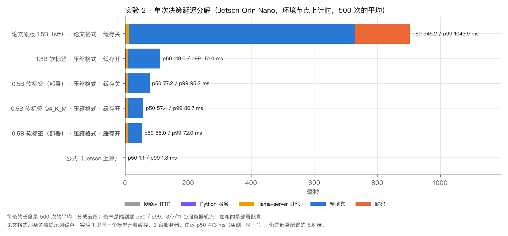
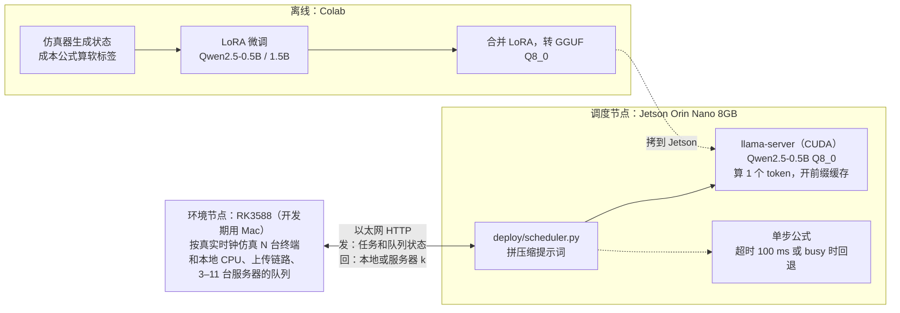

# comllm-edge-scheduler

**English summary.** This repository deploys an LLM-based task-offloading scheduler for mobile edge computing on an NVIDIA Jetson Orin Nano 8GB, building on the open-source paper COMLLM (Yang, Cheng and Zhang, [arXiv:2604.07148](https://arxiv.org/abs/2604.07148)). Qwen2.5-0.5B/1.5B are LoRA-fine-tuned on soft labels from the paper's one-step cost model and served by llama.cpp (CUDA) with a compact prompt, a one-token answer and prefix caching. An environment node simulates terminals and edge servers in real time and asks the Jetson for every decision over Ethernet, so decision latency counts toward task delay. Measured on the board, a decision takes 55.0 ms p50 / 72.0 ms p99, against 945.2 ms p50 for the paper-format 1.5B model on the same board. One scheduler node stays stable up to 7 terminals (theory 7.9), and up to at least 20 with overload shedding. In simulation, sequential decisions with virtual state updates cut mean delay by 18.1% against batch herding (11 servers, 80 terminals), and the 0.5B model stays within −0.1% to +0.5% of the one-step optimum across seven server counts from 3 to 11, including four never seen in training. We also train a second 0.5B whose teacher is a processor-sharing-aware version of the paper's delay formula; in a 3-server closed loop it cuts mean delay by a further 9.9–19.6% (simulation, one seed; the simulator itself uses processor sharing, which favours this teacher). This is an independent project based on the paper, not an official COMLLM release. The documentation below is in Chinese.

基于开源论文 COMLLM（arXiv:2604.07148）的任务卸载调度器端侧部署。Jetson Orin Nano 8GB 做调度节点（llama.cpp/CUDA）；环境节点按真实时钟仿真终端和边缘服务器，经以太网向 Jetson 要每一个决策，决策的耗时算进任务延迟。环境节点最终用 RK3588，开发期用 Mac 代替。

> 状态（2026-11-08）：部署和闭环实验做完；评测矩阵（PS 老师的两个 1.5B 学生、Jetson 开环、Colab 闭环、复现的 COMLLM-7B）11/13 前补齐。RK3588 当环境节点的两板复测排在 11/16–11/18；在那之前，所有实时数字都是 Mac 当环境节点测的。

## 这个项目做了两件事

1. **在论文的评价体系里，看更小的模型能不能到 7B 的水平。** 开环、用论文的单步最优打分（PR，式 28–29），比我们的 0.5B/1.5B、原作者的 1.5B 和 COMLLM-7B。论文报的 COMLLM-7B 是 96.86%，权重拿不到，所以按论文方法从原作者的 SFT-7B 复现一个，在同一份测试集上比（复现的不一定等于原版）。部署的 0.5B 在 Jetson 上一次决策 55 ms。
2. **在论文自己的假设下，换一个更贴合这个假设的老师。** 论文假设服务器平分算力（式 4），调度和打分用的时延近似在高负载时偏悲观。按式 4 推出 PS 感知公式当第二个老师，同样训练 0.5B/1.5B 学生；闭环里先比两个老师，再比各自的学生。

两部分的学生学的都是公式，不是 7B 模型的输出。开环和闭环在 Colab（PyTorch 原精度）和 Jetson（GGUF Q8_0）上分别跑，两边的差别就是部署带来的变化；7B 只在 Colab 上跑。

## 结果一览

全部实测；标"仿真"的是在仿真器里跑出来的。每个数字来自哪个运行目录，见 [figures/numbers.md](figures/numbers.md)。

| 问题 | 结果 | 条件 | 图 |
|---|---|---|---|
| 一次决策要多久 | 部署配置 p50 55.0 ms、p99 72.0 ms；同一块板上论文原版 1.5B（论文格式）p50 945.2 ms | Jetson 端到端，环境节点计时，500 次，3/7/11 台服务器轮流。部署配置 = 0.5B Q8_0 + 压缩提示词 + 1 个 token + 前缀缓存 | 图 2 |
| 同样大小（1.5B）能快多少 | 压缩提示词 + 前缀缓存 p50 118.0 ms，论文格式 945.2 ms；平均提示词 278 token 对 1358 token | 同上 | 图 2 |
| 一个调度节点撑得住多少终端 | 0.5B 最多 7 台（理论 7.9）；加超载分流后测到的 20 台也稳，丢弃 1.0%；论文原版 1.5B 1 台就丢 93.4% | 实时闭环，3 台服务器，每点 3 分钟、2 个种子 | 图 1 |
| 批量决策的羊群效应 | 改成顺序决策 + 虚拟状态更新：平均延迟 5.11 → 4.19 槽（−18.1%），丢弃 2.4% → 0.1%。3 台服务器时反而变差（+9.3%），原因见下面"局限" | 仿真，11 台服务器、80 台终端，单步最优公式 | 图 3 |
| 没见过的服务器台数 | 0.5B 闭环平均延迟和单步最优差 −0.1% ~ +0.5%；开环准确率 96.5%（见过的台数）、94.4%（没见过的台数） | 闭环：仿真，N = 40，3/4/6/7/8/10/11 台；开环：3010 条和 2408 条 | 图 4 |
| PS 公式和论文公式在闭环里比 | 公式对公式：PS 公式平均延迟平均低 9.27%（−22.73% ~ +3.79%）。照它们训练的两个 0.5B：PS 那个低 13.4% / 19.6% / 9.9%，丢弃 0.1% / 5.9% / 17.3% → 0.0% / 0.0% / 0.9% | 仿真，虚拟时间闭环，顺序决策。公式：3/7/11 台 × N = 20–80，3 个种子；0.5B：3 台、N = 20/40/60，1 个种子。仿真器按论文式 4 的平分算力排队，结论只适用于这种服务器 | 图 6、图 7 |
| 和原作者的 1.5B 比 | 原作者干净测试集上准确率：我们的 0.5B 95.9%，原作者 sft 1.5B 13.5% | 245 条，贪心解码；准确率 = 和单步最优选得一样的比例 | 图 6 |





另外三张图：[图 5 开环 vs 闭环](figures/fig5_open_vs_closed.png)、[图 6 消融](figures/fig6_ablation.png)、[图 7 LACS 在闭环里的效果](figures/fig7_lacs.png)。

## 两个老师：开环和闭环要分开看

论文的开环指标（AL、PR，式 26–29）在一组互相独立的状态上，用论文的时延公式给每个决策打分，参照答案是这个公式下的单步最优。所以开环比的其实是模型有多像这个公式。部署的 0.5B 在原作者测试集上 PR 99.94%，已经接近上限。论文的 LACS 在 λ = 0.3 下几乎不改变决策：闭环里 99.7% 的决策和单步最优一样，平均延迟只差 +0.04%（仿真）。

所以开环只用这一把尺子：我们的模型和论文原版模型都按单步最优打分。

闭环里每个决策都会改变后面任务看到的队列，延迟和丢弃率由仿真器里真实发生的排队决定，比的是对眼前和后面积压的处理。我们发现论文的时延近似在平分算力（PS）服务器上、高负载时偏悲观：已有的积压被算了两遍，上传期间服务器已经处理掉的积压也没扣掉。按论文自己的 PS 服务器模型（式 4）推出 PS 感知公式，用它当第二个老师，同样训练一个 0.5B。闭环里比的就是这两个公式，以及照它们训练的两个 0.5B（虚拟时间，顺序决策）：

| | 论文公式当老师（部署） | PS 感知公式当老师 |
|---|---|---|
| 公式对公式，3/7/11 台 × N = 20–80（12 个点，3 个种子） | 基准 | 平均延迟平均低 9.27%，范围 −22.73% ~ +3.79% |
| 公式本身，3 台、N = 40 | 5.28 槽，丢弃 6.0% | 4.12 槽，丢弃 0.0% |
| 0.5B 学生，3 台、N = 40 | 5.29 槽，丢弃 5.9% | 4.25 槽，丢弃 0.0% |
| 学生比自己的老师，3 台、N = 20/40/60 | −0.1% ~ +0.2% | −1.6% ~ +3.2% |
| 开环：论文的 PR（原作者测试集） | 99.94% | 74.1% |
| 台数泛化（闭环，3–11 台） | 和单步最优差 −0.1% ~ +0.5% | 没测 |
| Jetson 实时：单次决策、稳定边界 | 55.0 ms，7 台终端 | 没测 |

PS 公式在轻负载时和论文公式差不多（N = 20 时 7 台慢 0.07%、11 台慢 3.79%），负载越高越占优（7 台、N = 80 时快 22.73%）。PS 学生在开环 PR 上只有 74.1%，因为开环的尺子就是论文公式；它好不好要看闭环。

比法对两个公式是一样的：同一个仿真器、同一串任务、同样的种子，两个公式看到的信息也一样。仿真器的服务器按论文式 4 自己写的平分算力排队，PS 感知公式正是从这个假设推出来的，所以这是在论文自己的假设下比，PS 公式更贴合这个假设。结论只适用于平分算力的服务器；先来先服务的服务器上谁更好要另外测，这个对照还没做。

## 系统



- **环境节点**按 0.1 s 一个时间槽推进仿真，终端每槽以 0.3 的概率产生任务。每来一个任务，就把任务大小和各队列的状态发给 Jetson，收到决策才把任务放进对应的队列。所有时间戳都在这一侧记，两块板不用对时。
- **调度节点**只做决策。等 LLM 超过 100 ms，或上一个 LLM 请求还没算完，就当场用单步公式回答，并在日志里记下原因。
- 两块板分开放，是为了让网络那一跳和环境节点的排队都算进延迟，也不让仿真和 LLM 抢同一颗 CPU。

## 做了什么

1. **训练。** 自己写的仿真器在 3/5/7/9/11 台服务器上生成状态，每个动作用论文的单步成本公式算成本，软标签 = softmax(−成本 / T)。每次抽 4 万条，LoRA 微调 Qwen2.5-0.5B 和 1.5B，只在答案那 1 个 token 上算 KL。论文的 COMLLM-7B 权重拿不到，所以老师是公式，不是 7B 模型。0.5B 和 1.5B 的质量几乎一样，部署 0.5B。另用 PS 感知公式当老师训练了一个 0.5B，作为第二条线（见上一节）。
2. **加速。** 提示词压缩成每台服务器一行数字，答案是 1 个字母。llama-server 只算 1 个 token，在概率最高的 20 个候选里取最大的合法字母，不用生成，也不用语法约束。静态说明放在前缀，开 KV 缓存。只算 1 个 token 时 INT4 不比 Q8_0 快，所以用 Q8_0。
3. **系统评测。** 实时闭环按真实时钟跑，决策的耗时算进任务延迟，用来量稳定边界。虚拟时间闭环每个决策都等 Jetson 答完再往下走，决策耗时不计入，用来在 N = 20–80 的重负载下比决策质量：羊群效应、台数泛化、开环 vs 闭环、平分算力标签、LACS 往后看。
4. **GRPO 诊断。** 原作者的 1.5B 偏向服务器 1。这个偏向在 sft 模型里就有，贪心解码把它放大。从原作者 sft 出发做 GRPO，原作者干净测试集准确率从 13.5% 升到 81.2%（修正后的奖励）和 87.8%（原作者仓库的奖励）。我们的硬标签 1.5B 已经在公式上限，再做 GRPO 反而略降（见过的台数 96.0% → 92.9%）。

每一步的命令、参数和完整结果在 [docs/stages.md](docs/stages.md)。

## 复现

```bash
git clone https://github.com/Baro7ue/comllm-edge-scheduler.git
cd comllm-edge-scheduler
python3 -m venv .venv
source .venv/bin/activate
pip install -r requirements.txt
python -m unittest discover -s tests     # 81 个测试；没有原作者数据时跳过其中 5 个
python -m eval.figures                   # 从 runs/ 里的 CSV 重画 7 张图，并写出 figures/numbers.md
```

- 仓库带着所有实验的原始结果（`runs/`），所以不接 Jetson 也能重画全部图、核对每个数字。
- 训练（Colab）、Jetson 部署和每个实验的命令按阶段写在 [docs/stages.md](docs/stages.md)。
- 硬件、JetPack、llama.cpp 提交号、Qwen 权重的版本在 [docs/versions.md](docs/versions.md)。
- 原作者的模型和数据集不随仓库发布；用到它们的测试找不到数据时自动跳过。

## 局限

- **环境是仿真的。** 终端、上传链路和边缘服务器都是仿真器里的队列，参数取自论文表 I 和原作者的数据集。真实的只有调度节点和网络那一跳。
- **两个老师都是单步公式，学生的上限就是老师。** 论文公式在闭环高负载下高估平分算力服务器的排队。按平分算力推导的 PS 感知贪心比它平均快 9.27%、最多快 22.73%（仿真，3/7/11 台 × N = 20–80，顺序决策）。3 台服务器时改成顺序决策反而变差，也是因为这个高估被一个个叠加。
- **PS 老师那条线测得少。** 它的学生只在 3 台服务器、1 个种子上跑了闭环，台数泛化和 Jetson 实时数字都没测；优势是在平分算力的服务器上测的，先来先服务的服务器上没测。
- **闭环质量对比用虚拟时间，样本少。** LLM 的虚拟时间点只跑了 1 个种子，实时闭环每点 2 个种子、3 分钟。差别在 1% 以内的结论只说"分不开"。
- **平均延迟只算完成的任务。** 丢得多的策略会显得快，一定要和丢弃率一起看。
- **没有和 COMLLM-7B 直接比。** 它的权重拿不到；论文报的数字用的是另一份测试集，不和这里的数字放在一起。
- **原作者的测试集按答案配平过**，分布和闭环里遇到的状态不一样，所以它只作为补充测试集。
- **只测了一块 Jetson Orin Nano 8GB**（MAXN_SUPER，llama.cpp 5aeac37a3），环境节点到目前只用过 Mac。

## 和原论文的差别

仿真、训练和评测有 10 处和论文不一样，每处的原因和影响在 [docs/stages.md](docs/stages.md#和原论文的差别)。影响最大的三处：服务器按平分算力仿真，而调度和标签仍用论文式 5–7 的排队近似；评测改成闭环；训练用 3/5/7/9/11 台混合，4/6/8/10 台只用来测泛化。

## 目录

- `sim/`：仿真器、基线策略、两种提示词渲染器
- `deploy/`：Jetson 上的调度服务、提示词、测试床配置 `testbed.json`
- `train/`：训练数据生成（本机）和 Colab notebook
- `eval/`：实时闭环、虚拟时间闭环、延迟基准、开环评测、出图
- `runs/`：每次运行的结果，目录名是 UTC 时间加名字
- `evidence/`：各阶段的验收证据
- `figures/`：7 张图和 `numbers.md`
- `docs/`：各阶段记录 `stages.md`、版本记录 `versions.md`
- `tests/`：单元测试

## 致谢与引用

- 论文：Ning Yang, Chuangxin Cheng, Haijun Zhang. *Multi-Turn Reasoning LLMs for Task Offloading in Mobile Edge Computing*. arXiv:2604.07148。论文代码：[Cassandra-Cheng/COMLLM-MEC-Task-Offloading](https://github.com/Cassandra-Cheng/COMLLM-MEC-Task-Offloading)。
- 感谢原作者提供论文的 1.5B 模型和数据集用于对比；它们不随本仓库发布。
- 仿真环境的排队模型参考了 Tang 和 Wong 的工作（[arXiv:2005.02459](https://arxiv.org/abs/2005.02459)）。
- 模型用 [Qwen2.5](https://github.com/QwenLM/Qwen2.5)，推理用 [llama.cpp](https://github.com/ggml-org/llama.cpp)。

```bibtex
@article{yang2026comllm,
  title   = {Multi-Turn Reasoning LLMs for Task Offloading in Mobile Edge Computing},
  author  = {Yang, Ning and Cheng, Chuangxin and Zhang, Haijun},
  journal = {arXiv preprint arXiv:2604.07148},
  year    = {2026}
}
```
