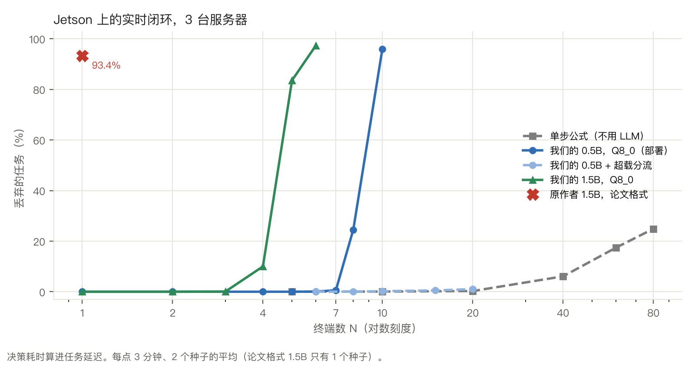
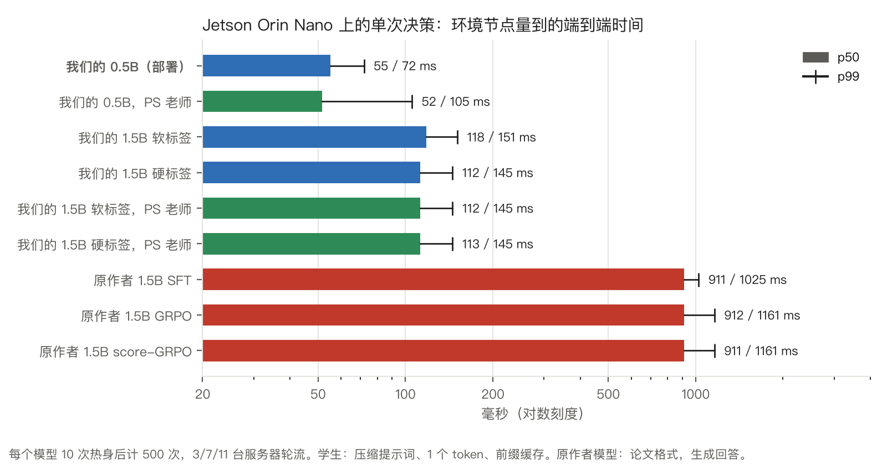
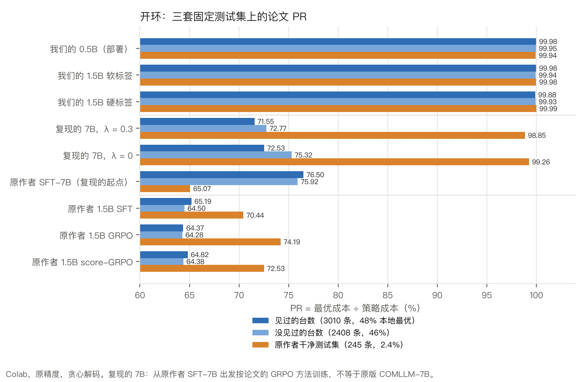
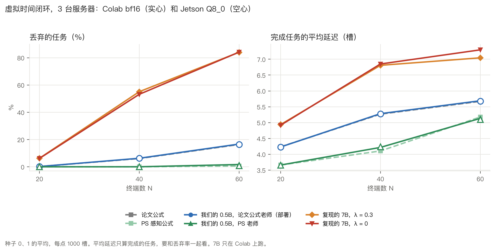
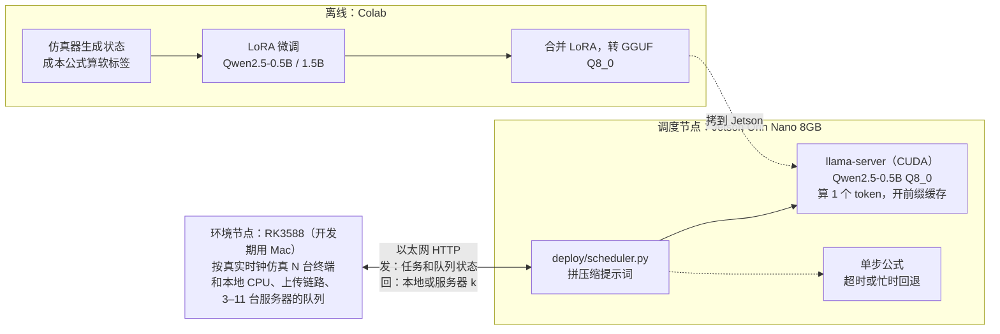

# COMLLM on Jetson：边缘端的 LLM 任务卸载调度

<p align="center">
  <a href="README.md"><kbd>&nbsp;English&nbsp;</kbd></a>
  &nbsp;
  <a href="README.zh-CN.md"><kbd>&nbsp;<b>简体中文</b>&nbsp;</kbd></a>
</p>

移动终端不断产生计算任务。每来一个任务，调度器要决定它留在终端本地算，还是卸载到 3 到 11 台边缘服务器中的
某一台。本项目把这个调度器放到 NVIDIA Jetson Orin Nano 8GB 上，依据的是开源论文 COMLLM（Yang、Cheng、Zhang，
[arXiv:2604.07148](https://arxiv.org/abs/2604.07148)）。我们没有用论文的 7B 模型，而是用论文的单步成本公式算出软标签，
LoRA 微调 Qwen2.5-0.5B 和 1.5B，再用 llama.cpp（CUDA）部署，提示词经过压缩，答案只有 1 个 token。
环境节点按真实时钟仿真终端、上传链路和服务器，经以太网向 Jetson 要每一个决策，所以决策花的时间会算进任务延迟。
终端和服务器是仿真的；调度节点和网络那一跳是真实的。

本项目是基于这篇论文的独立项目，不是 COMLLM 的官方版本。

## 结果

下面的数字全部实测；标"仿真"的是在仿真器里跑出来的，不是实时测试床。图里每个数字的出处运行目录列在
[docs/media/numbers.md](docs/media/numbers.md)，阶段 5 的数字列在 [figures/numbers.md](figures/numbers.md)。

| 问题 | 结果 | 条件 |
|---|---|---|
| 一次决策要多久 | 部署配置 p50 55.0 ms、p99 72.0 ms。原作者 1.5B 用论文格式的提示词，在同一块板上 p50 911.4 ms | Jetson，环境节点量到的端到端时间，500 次，3/7/11 台服务器轮流。部署配置 = 0.5B Q8_0、压缩提示词、1 个 token、前缀缓存 |
| 一个调度节点撑得住多少终端 | 7 台（理论 7.9）。加超载分流后至少 20 台，丢弃 1.0%。论文格式的 1.5B 只有 1 台终端就丢弃 93.4% | 实时闭环，3 台服务器，每点 3 分钟、2 个种子 |
| 批量决策会不会有羊群效应 | 会。改成一个一个决策、每次更新虚拟状态：平均延迟 5.11 → 4.19 槽（−18.1%），丢弃 2.4% → 0.1% | 仿真，11 台服务器、80 台终端，单步公式 |
| 训练时没见过的服务器台数 | 闭环平均延迟和单步最优差 −0.1% ~ +0.5%；开环准确率见过的台数 96.5%、没见过的台数 94.4% | 闭环：仿真，N = 40，3/4/6/7/8/10/11 台 |
| 换一个更贴合论文服务器模型的老师 | 公式对公式，PS 感知公式的平均延迟平均低 9.27%（−22.73% ~ +3.79%）。它的 0.5B 学生比论文公式老师的 0.5B 在 N = 20/40/60 时低 13.4% / 19.6% / 9.9%，丢弃 0.1% / 5.9% / 17.3% → 0.0% / 0.0% / 0.9% | 仿真，虚拟时间闭环，逐个决策。公式：3/7/11 台 × N = 20–80，3 个种子。学生：3 台、种子 0。仿真的服务器按论文式 4 平分算力，这正是 PS 感知公式的出发点 |
| 这个优势是不是因为仿真器按平分算力排队 | 不是。服务器换成先来先服务后，PS 感知公式的平均延迟比论文公式平均低 12.88%（−26.40% ~ +1.32%），丢弃 0.05%，论文公式 4.14% | 仿真，只比公式，同样的 12 个点和 3 个种子，服务器换成先来先服务。训练出的学生没有在先来先服务的服务器上跑 |
| 开环和 7B 比 | 论文公式老师的学生在三套测试集上 PR 99.88%–99.99%。复现的 7B 在原作者干净测试集上 98.85%–99.26%，在我们的两套上只有 71.55%–75.32%，原因是它从不选本地 | 论文的 PR（式 29）；3010 / 2408 / 245 条 |
| 部署会不会改变决策 | Colab（bf16）和 Jetson（Q8_0）的闭环：18 组学生设置里 17 组平均延迟相差不超过 0.04 槽、丢弃率相差不超过 0.83 个百分点。开环逐条答案相同的比例：论文公式老师的学生 97.13%–100.00%，PS 老师的两个软标签学生 66.53%–76.95% | 六个学生，3 台服务器，N = 20/40/60，2 个种子；开环 5663 条 |
| 复现的 7B 在闭环里 | 从不把任务留在本地；N = 40 时丢弃 53.15%–55.07%，N = 60 时 83.99%–84.10%；我们部署的 0.5B 分别是 6.26% 和 16.66% | Colab，虚拟时间，3 台服务器，2 个种子 |

### 板上实测

<p align="center">
  
</p>

实时闭环按真实时钟推进，决策慢了任务就跟着慢；一旦决策跟不上任务产生的速度，任务就开始错过截止期。
部署的 0.5B 最多撑 7 台终端，8 台时丢弃 24.5%。LLM 超过 100 ms 还没答完就改用单步公式（超载分流），20 台终端时丢弃 1.0%。
原作者的 1.5B 用论文格式的提示词、把答案生成出来，1 台终端就丢弃 93.4%。

<p align="center">
  
</p>

快的原因在提示词和答案，不只是模型小：同样是 1.5B，压缩提示词加前缀缓存 p50 是 112–118 ms，论文格式约 911 ms。
压缩提示词平均 278 个 token，论文格式 1358 个。原作者 SFT 模型早先测过一次 p50 945.2 ms，那时采样参数还没固定成贪心。

### 开环：三套测试集

<p align="center">
  
</p>

开环在固定的状态上用论文的成本公式给每个决策打分。三套测试集里"留在本地算最快"的比例差得很远：

| | 见过的台数（3/5/7/9/11） | 没见过的台数（4/6/8/10） | 原作者干净测试集 |
|---|---|---|---|
| 条数 | 3010 | 2408 | 245 |
| 本地最优占比 | 47.97% | 45.93% | 2.45%（6 条） |
| 从不选本地时准确率最多能到 | 52.03% | 54.07% | 97.55% |

原作者干净测试集是原作者的 306 条测试状态去掉和原作者训练数据重合的 61 条。这 61 条里 41 条本地最优，所以剩下的几乎不考本地。

- **复现的 7B 在 5663 条状态里一次都没选本地。** 它从原作者的 SFT-7B 出发，按论文的 GRPO 方法训练，λ = 0.3 和 λ = 0
  各训一个（`runs/20261108T103821Z_s7_colab_7b`）。SFT 模型会选本地，但不看状态：在干净测试集上选了 166 次本地，
  而本地最优只有 6 条。本地动作是在 GRPO 前 7 次更新里丢掉的。λ = 0 那次训练在这几步采到 41 个本地回答，35 个答在本该卸载的题上，
  其中 29 个被罚；第 7 次更新以后采到的 3208 个回答里一个本地都没有。答案解析、奖励计算和 λ 都排除过。
- 在最优是某台服务器的状态上，7B 选对服务器的比例是 62%–67%，我们的学生是 89%–94%。
- 这是论文方法加原作者数据的复现，不是原版 COMLLM-7B（权重拿不到），论文报的 96.86% 不和这里的数字放在一起比。
  我们的学生和 7B 的训练数据、方法、提示词格式和大小都不一样，不是只差模型大小的对照。另外，两套较大的测试集出自我们自己的仿真器，
  学生就是在这个仿真器上训练的。
- **原作者的设定为什么可能偏向卸载。** 这是一种解读，本项目没有验证：真实终端的 SoC 本来就在忙设备自己的事，把可以卸载的任务留在上面算，
  会拖慢这些正在执行的工作，所以设计者可能希望大部分任务都交给边缘。原作者的数据符合这个图景：本地最优在干净测试集里只占 2.45%，
  在 GRPO 的 830 条训练题里只有 49 条（5.9%），照这样的数据训练，模型没有多少理由保留本地动作。
  但论文的成本公式和我们的仿真器都没有给这种干扰计成本，两者只算任务自己的延迟。在我们的两套测试集上近一半状态本地最优，
  所以从不选本地会拉低 PR，在闭环里则表现为丢弃任务。要把这个想法落到实处，需要给"在终端上算"单独加一项成本。
  同样的解读对我们的测试集也是一个提醒：如果真实负载里很少出现"本地最优"，我们这两套就高估了"不会选本地"的影响。
  它们的本地最优占比来自负载（见过的台数上，N = 5 时 21.6%，N = 80 时 72.8%），也来自只算延迟。
  论文研究的是任务卸载，"大部分任务留在终端更好"的情形不在它要研究的范围内；我们的重负载恰好把模型放进了这种情形。
  两边都没有真实负载的数据可以对照。

完整的本地召回、本地精确，以及按台数和 N 的分解：[evidence/G6/open_loop.md](evidence/G6/open_loop.md)（Colab）和
[evidence/G6/jetson_open/comparison.md](evidence/G6/jetson_open/comparison.md)（Jetson）。

### 闭环：Colab 和 Jetson

<p align="center">
  
</p>

虚拟时间闭环每个决策都等答完再往下走，决策耗时不算，所以能在 N = 20–80 的重负载下比。每个决策都会改变后面任务看到的队列。

- **部署前后。** 六个学生在 Colab（合并 LoRA、bf16、A100）和 Jetson（GGUF Q8_0、llama.cpp）上跑同样的 36 个点，
  任务流完全相同，两边都没有回退到公式。18 组学生设置里 17 组平均延迟相差不超过 0.04 槽、丢弃率相差不超过 0.83 个百分点。
  汇总接近不等于每个决策都一样：开环里 PS 老师的两个软标签学生，Colab 和 Jetson 逐条答案相同的只有 66.53%–76.95%。
- **例外是 PS 老师的硬标签 1.5B 在 N = 60。** 4 次运行里有 3 次（Colab 两个种子、Jetson 种子 0）停止往服务器 3 派任务，
  丢弃 26%–29%；Jetson 种子 1 三台都用，丢弃 2.0%。没量化的模型也会这样。原因还没查。
- **复现的 7B** 在闭环里同样从不把任务留在本地，N = 60 时丢弃 84%。高负载下它的平均延迟看着低，只是因为只算完成的任务。
- **两个老师。** 论文假设服务器平分算力（式 4），但它的时延公式把已有积压算了两遍（[推导](docs/paper-delay-formula.zh-CN.md)），也没扣掉上传期间服务器已经处理掉的部分，
  所以高负载时偏悲观。按式 4 推出的 PS 感知公式当第二个老师。轻负载时它和论文公式差不多，负载越高越占优（7 台、N = 80 时平均延迟低 22.73%）。
  它的学生在开环里 PR 只有 65.57%–75.80%（Colab），因为开环的尺子就是论文公式。
- **这是不是仿真器带来的假象？** PS 感知公式和仿真器用的是同一个服务器模型。把服务器换成先来先服务（一次只算一个任务）做对照，答案是否定的：
  PS 感知公式在那里的平均延迟比论文公式低 12.88%，在平分算力的服务器上是 9.27%；12 个点里 11 个更快。专门为先来先服务写的公式，
  72 次运行里有 48 次和 PS 感知公式结果完全一样。所以优势不来自对"怎么分算力"的建模，而来自这两个公式的共同点：
  扣掉上传期间服务器已经算完的部分，不把积压再乘以活跃任务数。论文公式高估了服务器的延迟，把 58.3% 的任务留在终端，另外两个公式约 28%。
  这个对照只比了公式（`runs/20261114T120231Z_s6_fcfs_control`）。

逐点结果：学生在 Colab 上的见 `runs/20261112T064150Z_s6_colab_loop`，在 Jetson 上的见 `runs/20261107T071637Z_s5_virtual_e4a+e4b+e5`、`runs/20261108T044444Z_s5_virtual_e4ps_a` 和 `runs/20261108T094747Z_s5_virtual_e4ps_b`；7B 的报告在 `runs/20261113T104604Z_s7_colab_closed_loop`。

### 学生还会不会正常说话

学生只在"调度提示词 → 一个字母"上训练过，有可能丢掉原有的语言能力。我们在 Colab 上把每个没训练的基座和由它训练出的学生放在一起比
（`runs/20261115T123413Z_s8_language_check`；合并 LoRA，bf16）：

| 模型 | wikitext-2 困惑度 | 普通对话问题只答一个字母 | MMLU，按字母读答案 | MMLU，按选项原文读答案 |
|---|---|---|---|---|
| 没训练的 0.5B | 18.1 | 0/20 | 46.5% | 41.0% |
| 我们的 0.5B（部署） | 19.8 | 0/20 | 31.5% | 42.5% |
| 我们的 0.5B，PS 老师 | 19.3 | 0/20 | 30.5% | 40.0% |
| 没训练的 1.5B | 11.7 | 0/20 | 56.0% | 41.0% |
| 我们的 1.5B 软标签 | 11.9 | 0/20 | 53.5% | 44.5% |
| 我们的 1.5B 硬标签 | 12.2 | 0/20 | 54.0% | 45.5% |
| 我们的 1.5B 软标签，PS 老师 | 11.8 | 0/20 | 54.0% | 43.0% |
| 我们的 1.5B 硬标签，PS 老师 | 12.1 | 0/20 | 50.0% | 46.5% |

- **还会写句子。** 每个学生对 20 个普通问题都用句子回答；普通文本的困惑度，0.5B 学生高了 7%–9%，1.5B 学生高了 1%–4%。
- **0.5B 学生丢的是"用字母作答"这条通道。** 让它们用字母回答选择题，同样的 200 道 MMLU 题上准确率从 46.5% 降到 31.5% 和 30.5%（p < 0.001）。
  部署的那个 200 道里选了 106 次 A，PS 老师的那个选了 113 次 B；在调度提示词里 A 是本地执行，B 是服务器 1。
  改成看哪个选项的原文概率最大，两者和基座一样（42.5% 和 40.0%，基座 41.0%），说明知识还在。1.5B 学生按字母读没有显著下降（50.0%–54.0%，基座 56.0%）。
- 这是一次小规模检查：200 道 MMLU 题；20 个对话问题只按形式分类，没有判断答得对不对；量的是 Colab 上原精度的 PyTorch 模型，
  不是 Jetson 上的 Q8_0。逐条分析见 `runs/20261115T123413Z_s8_language_check/analysis.md`。

### 局限

- 终端、上传链路和服务器是仿真的，真实的只有调度节点和网络那一跳。仿真的服务器按论文式 4 平分算力。
  只比公式的对照表明 PS 感知公式在先来先服务的服务器上仍然占优，但训练出的学生没有在那里跑过。
- 两个老师都是单步公式，学生的上限就是老师。
- 闭环每点 2 个种子；结果表里 PS 老师那组 0.5B 对比只用了种子 0。PS 老师的硬标签 1.5B 在 N = 60 说明有时 2 个种子也不够。
  差别在 1% 以内的只说"分不开"。
- 平均延迟只算完成的任务，一定要和丢弃率一起看。
- 复现的 7B 不是原版 COMLLM-7B，只在 Colab 上跑。它的闭环解码用 `max_new_tokens = 16`、`repetition_penalty = 1.05`，
  开环用 15 和 1.0。"同样的数据下 7B 和小模型谁强"没有测。
- Colab 和 Jetson 汇总一致，不能说明 Q8_0 模型和 PyTorch 模型等价；这项调查暂缓。
- 只测了一块 Jetson Orin Nano 8GB（MAXN_SUPER，llama.cpp 5aeac37a3）。环境节点到目前只用过 Mac，RK3588 两板复测还没做。

## 系统怎么工作



- **环境节点**按 0.1 s 一个时间槽推进仿真，每台终端每槽以 0.3 的概率产生任务。每来一个任务，就把任务大小和各队列的状态发给 Jetson，
  收到决策才把任务放进对应的队列。所有时间戳都在这一侧记，两块板不用对时。
- **调度节点**只做决策。LLM 超过 100 ms 还没答，或上一个 LLM 请求还没算完，就当场用单步公式回答，并在日志里记下原因。
- **训练。** 我们的仿真器在 3/5/7/9/11 台服务器上生成状态，每个动作用论文的单步成本公式算成本，软标签 = softmax(−成本 / T)。
  每次 4 万条，LoRA 微调 Qwen2.5-0.5B 和 1.5B，只在答案那 1 个 token 上算 KL。论文的 7B 权重拿不到，所以老师是公式。
  0.5B 和 1.5B 的质量几乎一样，部署 0.5B。
- **加速。** 提示词里每台服务器一行数字，答案是 1 个字母。llama-server 只算 1 个 token，调度服务在概率最高的 20 个候选里取最大的合法字母，
  不用生成，也不用语法约束。静态说明放在前缀，开 KV 缓存。只算 1 个 token 时 INT4 不比 Q8_0 快，所以用 Q8_0。
- **从原作者 1.5B 出发做 GRPO。** 它偏向服务器 1，这个偏向在 SFT 模型里就有，贪心解码把它放大。GRPO 把干净测试集准确率从 13.5%
  提到 81.2%（修正后的奖励）和 87.8%（原作者的奖励），但在见过台数的 1000 条状态（N = 5/10/20）上只有 44.3% 和 52.1%。
  我们的硬标签 1.5B 已经在公式上限，再做 GRPO 反而略降（见过的台数 96.0% → 92.9%）。

## 各阶段

| 阶段 | 定下了什么 | 证据 |
|---|---|---|
| 0 | 仓库骨架，版本钉死 | `evidence/G0/` |
| 1 | 仿真器、基线策略、两种提示词渲染 | `evidence/G1/` |
| 2 | Jetson 调度服务、延迟基准、实时闭环 | `evidence/G2/` |
| 3 | 训练数据、Colab 上的 LoRA 训练、开环打分、GGUF 核对 | `evidence/G3/` |
| 4 | 从原作者 1.5B 和我们的硬标签 1.5B 出发做 GRPO | `evidence/G4/` |
| 5 | 闭环实验：容量、延迟、羊群效应、台数泛化、消融、LACS | `evidence/G5/`、`figures/` |
| 6 | PS 感知老师和它的先来先服务对照、三套测试集分开报开环、Colab 和 Jetson 的开环与闭环对比 | `evidence/G6/`、`runs/*_s6_*` |
| 7 | 按论文的 GRPO 方法复现 7B，在 Colab 上跑开环和闭环 | `evidence/S7/`、`runs/*_s7_*` |
| 8 | 学生有没有保住普通的语言能力 | `runs/*_s8_*` |

每个阶段的命令、参数和完整结果在 [docs/stages.zh-CN.md](docs/stages.zh-CN.md)，其中也列了仿真、训练和评测和论文不一样的 10 处。

## 仓库结构

| 路径 | 内容 |
|---|---|
| `sim/` | 仿真器、基线策略、压缩格式和论文格式两种提示词渲染 |
| `deploy/` | Jetson 上的调度服务、提示词、测试床配置 `testbed.json` |
| `train/` | 训练数据生成和 Colab notebook（LoRA、GRPO、7B 复现、GGUF 转换） |
| `eval/` | 实时闭环、虚拟时间闭环、延迟基准、开环打分、Colab 闭环、先来先服务对照、出图 |
| `runs/` | 每次运行的原始结果，一次一个目录，按 UTC 时间命名 |
| `evidence/` | 各阶段的验收证据 |
| `figures/` | 阶段 5 的 7 张图和 `numbers.md` |
| `docs/` | 各阶段记录 `stages.zh-CN.md`、版本记录 `versions.zh-CN.md`（英文版不带 `.zh-CN`）、改写历史前后的提交号对照 `commit-map.md`，README 配图在 `media/` |
| `tests/` | 单元测试 |

## 运行

```bash
git clone https://github.com/Baro7ue/comllm-edge-scheduler.git
cd comllm-edge-scheduler
python3 -m venv .venv
source .venv/bin/activate
pip install -r requirements.txt
python -m unittest discover -s tests
python -m eval.readme_figures            # README 的 4 张中英文配图
python -m eval.figures                   # 阶段 5 的 7 张图和 figures/numbers.md
```

- `runs/` 带着所有实验的原始结果，不接 Jetson 也能重画全部图、核对每个数字。
- Colab 训练、Jetson 部署和每个实验的命令在 [docs/stages.zh-CN.md](docs/stages.zh-CN.md)；硬件、JetPack、llama.cpp 提交号和 Qwen 权重版本在
  [docs/versions.zh-CN.md](docs/versions.zh-CN.md)。
- 原作者的模型和数据集不随仓库发布；用到它们的测试找不到文件时自动跳过。

## 致谢、许可与引用

- 论文：Ning Yang, Chuangxin Cheng, Haijun Zhang. *Multi-Turn Reasoning LLMs for Task Offloading in Mobile Edge Computing*.
  arXiv:2604.07148。论文代码：[Cassandra-Cheng/COMLLM-MEC-Task-Offloading](https://github.com/Cassandra-Cheng/COMLLM-MEC-Task-Offloading)。
- 感谢原作者提供论文的 1.5B 模型和数据集用于对比；它们不随本仓库发布。
- 仿真器的排队模型参考了 Tang 和 Wong 的工作（[arXiv:2005.02459](https://arxiv.org/abs/2005.02459)）。
- 模型用 [Qwen2.5](https://github.com/QwenLM/Qwen2.5)，推理用 [llama.cpp](https://github.com/ggml-org/llama.cpp)。

本项目自己的代码、文档和结果采用 Apache License 2.0（[LICENSE](LICENSE)）。第三方材料保留各自的条款，列在
[THIRD_PARTY_NOTICES.md](THIRD_PARTY_NOTICES.md)；论文格式的提示词模板属于原作者，沿用其仓库的 MIT 许可。

```bibtex
@article{yang2026comllm,
  title   = {Multi-Turn Reasoning LLMs for Task Offloading in Mobile Edge Computing},
  author  = {Yang, Ning and Cheng, Chuangxin and Zhang, Haijun},
  journal = {arXiv preprint arXiv:2604.07148},
  year    = {2026}
}
```
