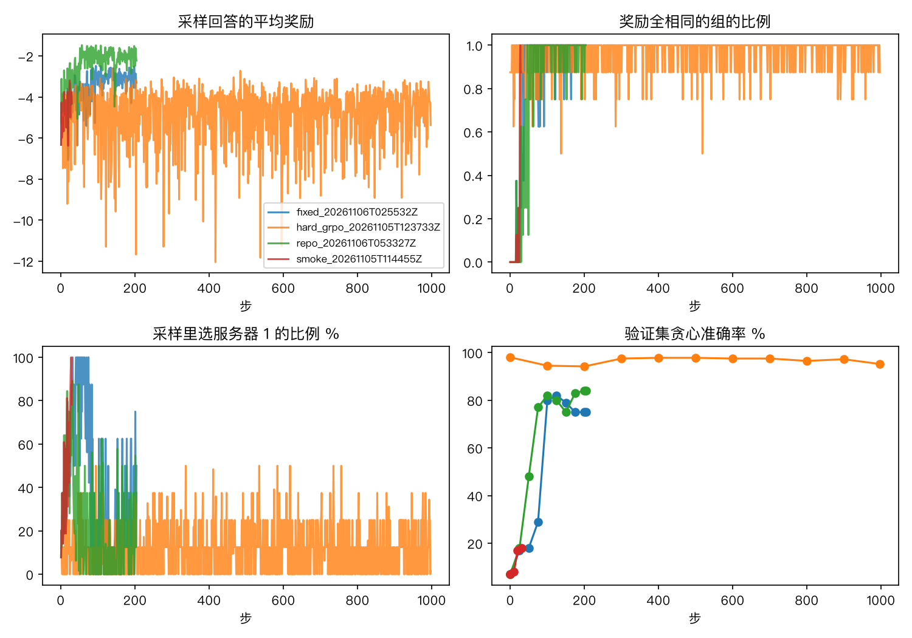

# 阶段 4：动作分布和 GRPO 训练

由 `python -m eval.grpo_report` 生成。整句概率含结尾的 <|im_end|>；0.7 是原作者评测脚本的采样温度。

### 原作者干净测试集

| 模型 | 条数 | 整句最大概率 准确率 % | 贪心 准确率 % | 两者相同 % | 合法动作概率和 % | 0.7 采样期望准确率 % | 服务器 1 平均概率 % |
|---|---|---|---|---|---|---|---|
| 论文原版 sft | 245 | 10.6 | 13.5 | 68.6 | 97.5 | 12.4 | 28.8 |
| 论文原版 grpo | 245 | 11.0 | 13.9 | 60.4 | 97.7 | 12.7 | 30.0 |
| 论文原版 score-grpo | 245 | 11.0 | 13.5 | 61.2 | 97.6 | 12.6 | 29.6 |
| fixed_20261106T025532Z | 245 | 81.2 | 81.2 | 100.0 | 99.9 | 81.2 | 22.0 |
| repo_20261106T053327Z | 245 | 86.9 | 87.8 | 99.2 | 98.6 | 86.9 | 16.3 |

### test_seen 里 11 台

| 模型 | 条数 | 整句最大概率 准确率 % | 贪心 准确率 % | 两者相同 % | 合法动作概率和 % | 0.7 采样期望准确率 % | 服务器 1 平均概率 % |
|---|---|---|---|---|---|---|---|
| 论文原版 sft | 200 | 22.5 | 21.5 | 98.0 | 96.9 | 17.8 | 10.9 |
| 论文原版 grpo | 200 | 22.5 | 14.5 | 59.5 | 97.1 | 17.1 | 11.9 |
| 论文原版 score-grpo | 200 | 22.5 | 17.0 | 76.0 | 97.1 | 17.1 | 11.8 |
| fixed_20261106T025532Z | 200 | 43.0 | 43.0 | 100.0 | 99.9 | 43.0 | 33.0 |
| repo_20261106T053327Z | 200 | 36.5 | 46.0 | 78.5 | 77.5 | 36.4 | 3.9 |

### 动作占比 %（11 台，对照论文表 V）

| 来源 | 条数 | 本地 | S1 | S2 | S3 | S4 | S5 | S6 | S7 | S8 | S9 | S10 | S11 |
|---|---|---|---|---|---|---|---|---|---|---|---|---|---|
| 论文表 V SFT-1.5B | 306（合计 260） | 13.4 | 19.3 | 11.4 | 8.8 | 9.2 | 8.5 | 1.3 | 0.0 | 4.6 | 5.2 | 0.7 | 2.6 |
| 论文表 V GRPO-1.5B | 306（合计 306） | 3.9 | 62.7 | 14.1 | 3.3 | 6.2 | 3.3 | 0.3 | 0.0 | 1.3 | 3.3 | 0.0 | 1.6 |
| 论文原版 sft · 0.7 采样期望 | 200 | 60.5 | 13.1 | 10.8 | 5.4 | 5.4 | 1.5 | 1.5 | 1.1 | 0.4 | 0.3 | 0.0 | 0.0 |
| 论文原版 sft · 贪心 | 200 | 98.0 | 2.0 | 0.0 | 0.0 | 0.0 | 0.0 | 0.0 | 0.0 | 0.0 | 0.0 | 0.0 | 0.0 |
| 论文原版 grpo · 0.7 采样期望 | 200 | 54.4 | 15.0 | 12.6 | 6.2 | 6.2 | 1.8 | 1.7 | 1.3 | 0.5 | 0.3 | 0.0 | 0.0 |
| 论文原版 grpo · 贪心 | 200 | 59.5 | 40.5 | 0.0 | 0.0 | 0.0 | 0.0 | 0.0 | 0.0 | 0.0 | 0.0 | 0.0 | 0.0 |
| 论文原版 score-grpo · 0.7 采样期望 | 200 | 55.6 | 14.6 | 12.3 | 6.1 | 6.0 | 1.7 | 1.6 | 1.2 | 0.5 | 0.3 | 0.0 | 0.0 |
| 论文原版 score-grpo · 贪心 | 200 | 76.0 | 23.5 | 0.5 | 0.0 | 0.0 | 0.0 | 0.0 | 0.0 | 0.0 | 0.0 | 0.0 | 0.0 |
| fixed_20261106T025532Z · 0.7 采样期望 | 200 | 0.0 | 33.0 | 12.0 | 8.5 | 22.5 | 5.5 | 2.0 | 1.0 | 4.0 | 4.0 | 3.5 | 4.0 |
| fixed_20261106T025532Z · 贪心 | 200 | 0.0 | 33.0 | 12.0 | 8.5 | 22.5 | 5.5 | 2.0 | 1.0 | 4.0 | 4.0 | 3.5 | 4.0 |
| repo_20261106T053327Z · 0.7 采样期望 | 200 | 0.0 | 4.1 | 12.5 | 8.0 | 26.4 | 6.5 | 2.5 | 2.0 | 4.1 | 4.5 | 4.0 | 25.4 |
| repo_20261106T053327Z · 贪心 | 200 | 0.0 | 25.5 | 12.5 | 8.0 | 26.5 | 6.5 | 2.5 | 2.0 | 4.0 | 4.5 | 4.0 | 4.0 |

论文表 V 的 SFT-1.5B 一行只有 260 个决策，剩下 46 个应该是认不出的回答；占比仍按 306 算。

## 训练

| 运行 | 步数 | 用时（分钟） | 验证集准确率 % 第 0 步 → 最后 | 最后 10 步 全相同组比例 | 最后 10 步 非法 % |
|---|---|---|---|---|---|
| fixed_20261106T025532Z | 204 | 39.7 | 7.0 → 75.0 | 1.00 | 0.0 |
| hard_grpo_20261105T123733Z | 997 | 9.3 | 98.0 → 95.2 | 0.97 | 0.0 |
| repo_20261106T053327Z | 204 | 39.9 | 7.0 → 84.0 | 0.99 | 0.0 |
| smoke_20261105T114455Z | 30 | 6.2 | 7.0 → 18.0 | 0.45 | 0.0 |

